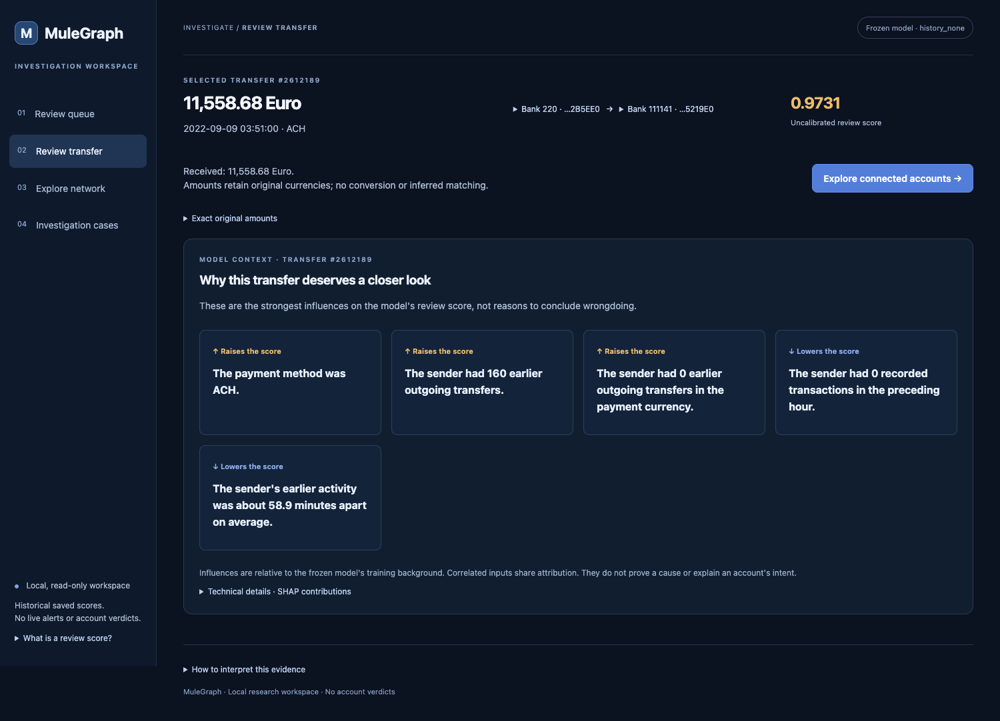
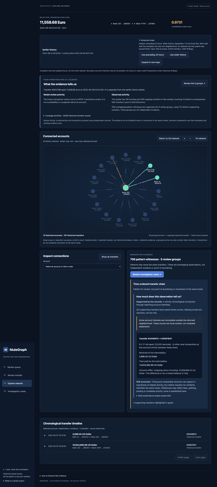
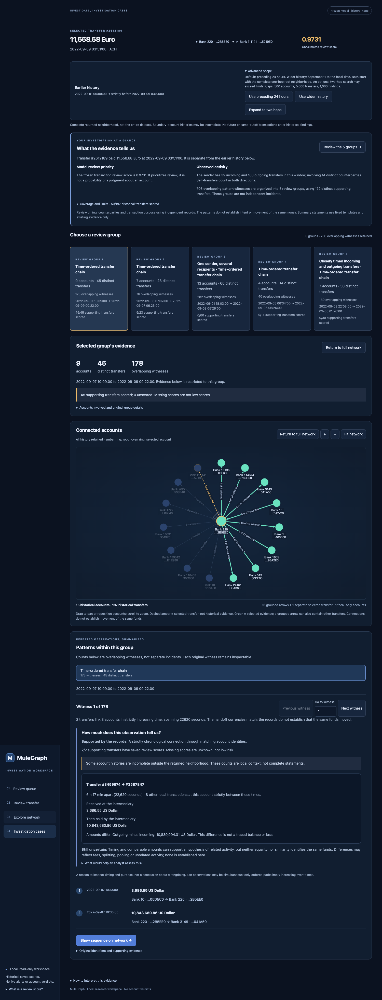
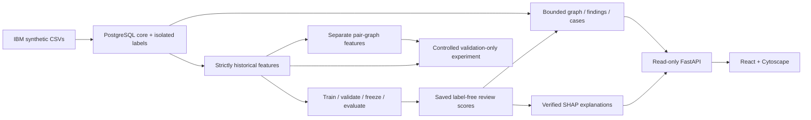

# MuleGraph

**Transaction risk scoring and network investigation**

MuleGraph helps an analyst prioritize suspicious transfers, explore connected
accounts, and inspect the evidence behind a review score. Built on IBM's synthetic
AML HI-Small dataset, it combines PostgreSQL data pipelines, time-aware machine
learning, and bounded network analysis in a local React application.

This is a retrospective portfolio project. Scores prioritize review; they do not
establish financial crime.

**Start here:** [Architecture](docs/architecture.md) · [Model results](#measured-results) ·
[Run the tests](#try-the-code-without-downloading-data) · [Demo walkthrough](docs/demo_walkthrough.md)

## See the analyst workflow

**1. Understand the score.** Review a transfer and inspect the strongest influences
on its frozen LightGBM score through native TreeSHAP explanations.



**2. Explore the network → 3. Inspect the evidence.** Follow connected accounts,
select a review group, and trace its supporting transfers in time order.

<details>
<summary><strong>Explore connected accounts and selected transfer evidence</strong></summary>



The wider history contains **15 historical accounts and 197 transfers**. Selected
evidence is highlighted in green; the focal transfer stays separate from history.
The panel exposes exact amounts, elapsed time, score coverage, and uncertainty.
Connections do not establish movement of the same funds.

</details>

<details>
<summary><strong>Inspect review groups and their supporting evidence</strong></summary>



**706 overlapping pattern witnesses** are organized into **five review groups**.
The selected group retains its original evidence and reports missing scores
explicitly. Group counts are not independent incidents or criminal findings.

</details>

*Actual application captures from October 15, 2026 using IBM's synthetic HI-Small
data; these are saved demo views, not a hosted live service. Visible synthetic data
excerpts are provided under [CDLA-Sharing-1.0](https://cdla.dev/sharing-1-0/).
[Image provenance and attribution](docs/screenshots/README.md) ·
[Five-minute walkthrough](docs/demo_walkthrough.md).*

## What it does

- Preserves **5,078,345 source transactions**, including duplicates, with exact
  monetary values, composite bank/account identities and isolated transaction labels.
- Builds strictly historical account activity and separate directed account-pair
  features, excluding future events and same-timestamp peers.
- Compares rules, Logistic Regression and LightGBM using chronological splits,
  training-only preprocessing, predeclared experiments and frozen thresholds.
- Investigates bounded networks for fan-in/out, ordered chains/cycles and rapid
  movement; groups overlapping witnesses into explainable review cases.
- Explains saved scores through verified native TreeSHAP and shows exact handoff
  amounts, timing, missing scores and incomplete context alongside evidence.
- Assists analysts with deterministic evidence summaries, review questions and
  explicit uncertainty; summaries use fixed templates, with no LLM or external API.
- Provides a React/Cytoscape investigation workflow with a read-only FastAPI layer.
  Streamlit remains a fallback. Neither interface exposes ground-truth labels.

## Architecture



The graph-feature experiment is separate from the frozen application model and its
saved scores. [Architecture and contracts](docs/architecture.md).

**Stack:** Python 3.12, PostgreSQL 17, Psycopg, Arrow/Parquet, DuckDB, NumPy,
scikit-learn, LightGBM/native TreeSHAP, NetworkX, FastAPI, React, Cytoscape.js,
Streamlit/Plotly, Pytest, Playwright, Ruff, uv and npm locks.

## Measured results

The application uses frozen **`lightgbm-stable-v1/history_none`**. Primary test
is September 9–10, 2022: 862,792 rows, prevalence 0.1108%. These are development
holdouts because earlier EDA/rules work inspected them.

| Primary-test metric | Frozen LightGBM | Logistic Regression |
| --- | ---: | ---: |
| Average Precision (AP) | 0.513960 | 0.171517 |
| ROC-AUC | 0.979857 | 0.961977 |
| Precision at 1% ranking budget | 8.3111% | 4.6134% |
| Recall at 1% ranking budget | 75.0000% | 41.6318% |
| Actual frozen-threshold alert rate | 1.5909% | 3.0552% |

LightGBM finds 717 positives among 8,627 ranked reviews. Rules AP is 0.001170,
ACH-only 0.006245 and prevalence 0.001108.
[All metrics, confusion matrices and stress results](docs/ml_holdout_report_v1.md).
Ranking a fixed 1% is different from applying the saved numeric threshold.

**Separate graph experiment:** two matched fits added four prior forward/reverse
interaction count/recency features. On the **reused September 7–8 validation**,
AP increased from **0.56054 to 0.62812**, and recall at 9,655 ranked reviews from
**79.54% to 83.01%** (+36 positives). This is exploratory evidence of additional
predictive information, not independently confirmed improvement on unseen data.
The experimental model has no new test/stress evaluation and is not used in the UI.
[Measured comparison and costs](docs/graph_prediction_report.md).

## Scope and limitations

Scores are uncalibrated review priorities; SHAP is not causal evidence. Both
frozen supervised thresholds miss all 122 non-ACH test positives. Stress has only
1,108 rows, 59.12% positives and 100% ACH, so its higher AP is not evidence of
improvement over test. Validation was reused; synthetic patterns may not generalize.
Event time is assumed to equal availability, and history begins at the dataset
start. Training transactions remain unscored. Local graph connections and ordered
witnesses do not prove movement of the same funds. Cases overlap and are not
independent criminal incidents. The application is localhost-only, without
production security or persistent case management.

## Try the code without downloading data

Prerequisites: Git, uv, Python 3.12 and Node.js 22.12+ with npm. On macOS,
LightGBM may require the OpenMP runtime (`brew install libomp`). From a checkout:

```sh
uv sync --locked
uv run --locked pytest
uv run --locked ruff check .
uv run --locked ruff format --check .
npm ci --prefix frontend
npm test --prefix frontend
npm run check --prefix frontend
npm run build --prefix frontend
```

Synthetic tests need no IBM data or model bundles. PostgreSQL tests skip unless
explicitly enabled. The full investigation app needs local data and saved artifacts;
it is not a bundled data-free demo. CI runs synthetic tests, including disposable
PostgreSQL schemas, plus frontend checks. See [two reproducibility paths](docs/reproducibility.md)
for installation, database setup, artifact dependencies and verification limits.
Exact reconstruction of the original model runs requires historical environments
that are not included in this source snapshot.

## Run the investigation demo with local artifacts

This path requires an existing compatible full-data workspace; installation and
tests alone do not create the database or saved models. See the
[artifact prerequisites](docs/reproducibility.md#application-prerequisites-and-replay).

```sh
uv run --locked --env-file .env uvicorn mulegraph.investigator_api:app \
  --host 127.0.0.1 --port 8000 --limit-concurrency 8
```

Build the frontend first using the commands above. Open http://127.0.0.1:8000,
search **2612189**, review its explanation, then explore connected accounts.
Follow the [five-minute walkthrough](docs/demo_walkthrough.md) for the narrow
scope, wider network, five review groups, chronological evidence and limitations.
Streamlit fallback: `uv run --locked --env-file .env streamlit run streamlit_app.py`.

## Engineering documentation

- [Architecture](docs/architecture.md) · [Reproduction](docs/reproducibility.md)
- [Schema/ingestion](docs/schema_and_ingestion.md) · [EDA](docs/eda_report.md)
- [Historical features](docs/historical_features.md) · [Graph predictors](docs/graph_prediction.md)
- [Model methodology](docs/supervised_learning.md) · [Stabilization](docs/ml_stabilization.md)
- [Graph investigation](docs/network_investigation.md) · [Cases](docs/case_intelligence.md)
- [SHAP](docs/shap_explanations.md) · [Evidence quality](docs/evidence_quality.md)
- [Documentation guide](docs/README.md) · [Verification record](docs/portfolio_release.md)

`src/mulegraph/` contains Python/SQL services; `frontend/` the React application;
`tests/` synthetic unit/integration tests; `docs/` contracts and aggregate reports.
Raw datasets, saved model/prediction bundles, credentials, and local captures stay
ignored. Three reviewed synthetic-data screenshots are included under
`docs/screenshots/` for the visual walkthrough.

## Attribution and licensing

Data: [IBM AML-Data](https://github.com/IBM/AML-Data), synthetic HI-Small, acquired
as Kaggle version 8. IBM identifies the **data** license as CDLA-Sharing-1.0;
its repository code license is separate. [Acquisition/provenance](docs/data_acquisition.md).
Raw dataset files are not redistributed. Screenshots contain limited synthetic
data excerpts under [CDLA-Sharing-1.0](https://cdla.dev/sharing-1-0/); see
[image attribution](docs/screenshots/README.md). No code license has been granted
in this snapshot. Third-party data and dependencies retain their own license terms.
