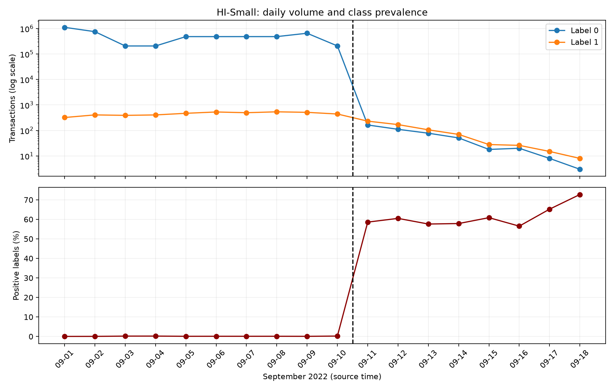
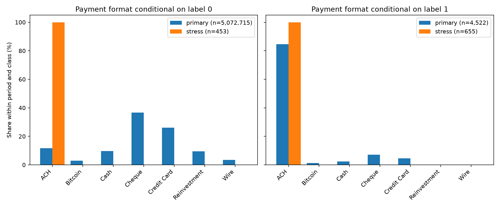
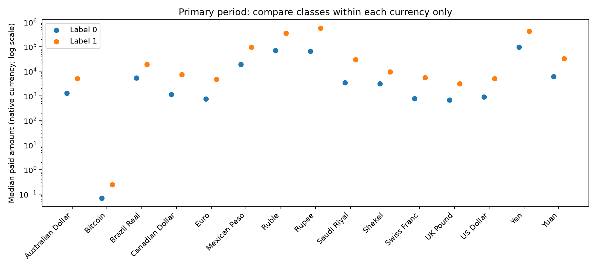

# exploratory analysis and temporal evaluation design

Generated 2026-10-14T00:00:22.687056+00:00. Dataset `ibm-aml-hi-small-v8`; fingerprint `676d1c42a92e495ca159fc0cadf28acd0e33598b728fdc236b6e089dd8f28240`. SQL SHA-256 `c73d6f9724887090824462209b8376878c0d9c0dce4eb2309075fc0c7e7b72ed`. Database aggregation took 153.085 seconds in this run (not a benchmark).

Execution and test evidence: [verification log](eda_verification.md).

## Scope and reproducibility

All observations below come from one PostgreSQL REPEATABLE READ, READ ONLY snapshot of the completed ingestion. SQL aggregates run on the server; Python receives only summary rows. No raw data, stored transactions, labels, or schema were changed. Both money columns remain exact NUMERIC; exact nearest-rank percentiles use percentile_disc. Only plotting converts values to floats. The dataset is synthetic: a positive label is a simulator annotation, not proof of real-world criminal conduct. Pattern annotations are not queried.

Run from the project root with the existing environment:

```sh
uv run --locked --env-file .env python -m mulegraph.eda
```

Outputs: ignored `data/eda/hi-small.json` (all aggregates), this report, and `docs/figures/eda/*.png`. SQL lives in `src/mulegraph/sql/eda_*.sql`; split policy and runner in `src/mulegraph/eda.py`. Dates use source naive timestamps; no timezone is invented. Same input snapshot and locked code reproduce aggregates; generation time and runtime naturally vary.

## Proposed chronological splits

| Split | Start inclusive | End exclusive | Rows | Positive | Negative | Positive % |
| --- | --- | --- | --- | --- | --- | --- |
| train | 2022-09-01T00:00:00 | 2022-09-07T00:00:00 | 3,248,921 | 2530 | 3,246,391 | 0.077872 |
| validation | 2022-09-07T00:00:00 | 2022-09-09T00:00:00 | 965,524 | 1036 | 964,488 | 0.107299 |
| test | 2022-09-09T00:00:00 | 2022-09-11T00:00:00 | 862,792 | 956 | 861,836 | 0.110803 |
| stress | 2022-09-11T00:00:00 | 2022-09-19T00:00:00 | 1,108 | 655 | 453 | 59.115523 |

The calendar allocation is six training days, two validation days, and two test days, rather than equal row counts. Freeze this proposal before modeling. Use validation for threshold and hyperparameter choices; use the primary test once after those choices. Stress results are separate, never pooled with primary test performance. This EDA has examined test labels, so this is a development holdout, not a pristine externally blinded test. A future untouched dataset is needed for stronger generalization claims.

## Temporal shift and imbalance

Primary: 5,077,237 rows and 4,522 positives (0.089064%). Stress: 1,108 rows and 655 positives (59.115523%). Positive prevalence rises 663.7×. This is a change in both transaction volume and class mixture, not merely a slightly later sample. The tail's small class counts limit stable comparisons.

ACH accounts for 1,108/1,108 stress rows and 3,828/4,522 primary positives. Among the 453 stress negatives, 391 are cross-currency and 390 are self-transfers. Across both periods, 0 positive rows are cross-currency. These strong class-conditional differences show distribution shift within classes; they are not universal financial-crime rules. A tail-only evaluation would test a very different task from the primary period.



| Day | Rows | Positive | Positive % | Self-transfers | Cross-currency |
| --- | --- | --- | --- | --- | --- |
| 2022-09-01 | 1114921 | 322 | 0.0289 | 507410 | 9572 |
| 2022-09-02 | 754449 | 408 | 0.0541 | 15480 | 11682 |
| 2022-09-03 | 207382 | 391 | 0.1885 | 4332 | 3181 |
| 2022-09-04 | 207430 | 407 | 0.1962 | 4364 | 3215 |
| 2022-09-05 | 482650 | 471 | 0.0976 | 10399 | 7722 |
| 2022-09-06 | 482089 | 531 | 0.1101 | 10401 | 7725 |
| 2022-09-07 | 482751 | 497 | 0.1030 | 10390 | 7715 |
| 2022-09-08 | 482773 | 539 | 0.1116 | 10408 | 7731 |
| 2022-09-09 | 654467 | 514 | 0.0785 | 13244 | 9993 |
| 2022-09-10 | 208325 | 442 | 0.2122 | 4391 | 3243 |
| 2022-09-11 | 396 | 232 | 58.5859 | 131 | 131 |
| 2022-09-12 | 281 | 170 | 60.4982 | 100 | 100 |
| 2022-09-13 | 184 | 106 | 57.6087 | 69 | 69 |
| 2022-09-14 | 121 | 70 | 57.8512 | 43 | 43 |
| 2022-09-15 | 46 | 28 | 60.8696 | 18 | 17 |
| 2022-09-16 | 46 | 26 | 56.5217 | 20 | 20 |
| 2022-09-17 | 23 | 15 | 65.2174 | 9 | 8 |
| 2022-09-18 | 11 | 8 | 72.7273 | 3 | 3 |

Class-conditional total variation distance below compares category shares between primary and stress (0 = identical, 1 = disjoint). Conditioning on the label separates composition changes from the large label-prior shift. These are descriptive distances, not significance tests or causal evidence.

| Category | Label | Primary→stress total variation |
| --- | --- | --- |
| payment_format | 0 | 0.88253607782026 |
| payment_format | 1 | 0.15347191508182223 |
| payment_currency | 0 | 0.09044005739758482 |
| payment_currency | 1 | 0.0940757821810926 |
| receiving_currency | 0 | 0.12996451284466687 |
| receiving_currency | 1 | 0.0940757821810926 |
| self_transfer | 0 | 0.7444587522599238 |
| self_transfer | 1 | 0.0028110239676424676 |
| cross_currency | 0 | 0.8489846415238811 |
| cross_currency | 1 | 0.0 |



A simulator boundary or annotation-related tail is a plausible explanation, but these observations do not establish how generation produced the shift. Do not infer a real-world increase in crime or remove tail rows. Treat it as a separate distribution-shift stress set. Review simulator generation details before assigning a causal explanation.

### Within-day activity

Peak hours below use source clock time, not a known local timezone. Shares condition on period and class; ties choose the earliest hour. All 24-hour aggregate counts are retained in the JSON. No business-hours or timezone interpretation is established by the source.

| Period | Label | Peak hour | Rows in hour | Class share % |
| --- | --- | --- | --- | --- |
| primary | 0 | 0 | 634542 | 12.51 |
| primary | 1 | 12 | 288 | 6.37 |
| stress | 0 | 13 | 38 | 8.39 |
| stress | 1 | 13 | 49 | 7.48 |

## Currency, format, and transfer behavior

### payment_format

| Value | Primary label 0 | Primary label 1 | Stress label 0 | Stress label 1 |
| --- | --- | --- | --- | --- |
| ACH | 595861 | 3828 | 453 | 655 |
| Bitcoin | 146035 | 56 | 0 | 0 |
| Cash | 490783 | 108 | 0 | 0 |
| Cheque | 1864007 | 324 | 0 | 0 |
| Credit Card | 1323118 | 206 | 0 | 0 |
| Reinvestment | 481056 | 0 | 0 | 0 |
| Wire | 171855 | 0 | 0 | 0 |

### payment_currency

| Value | Primary label 0 | Primary label 1 | Stress label 0 | Stress label 1 |
| --- | --- | --- | --- | --- |
| Australian Dollar | 136630 | 110 | 12 | 17 |
| Bitcoin | 146009 | 56 | 1 | 0 |
| Brazil Real | 70638 | 49 | 8 | 8 |
| Canadian Dollar | 139904 | 116 | 10 | 12 |
| Euro | 1166813 | 1211 | 112 | 161 |
| Mexican Peso | 110050 | 78 | 17 | 14 |
| Ruble | 155031 | 119 | 14 | 14 |
| Rupee | 190013 | 148 | 22 | 19 |
| Saudi Riyal | 88632 | 302 | 8 | 72 |
| Shekel | 192087 | 92 | 2 | 3 |
| Swiss Franc | 234654 | 162 | 13 | 31 |
| UK Pound | 180593 | 123 | 13 | 9 |
| US Dollar | 1893088 | 1668 | 172 | 244 |
| Yen | 155029 | 119 | 25 | 36 |
| Yuan | 213544 | 169 | 24 | 15 |

### receiving_currency

| Value | Primary label 0 | Primary label 1 | Stress label 0 | Stress label 1 |
| --- | --- | --- | --- | --- |
| Australian Dollar | 138366 | 110 | 18 | 17 |
| Bitcoin | 148095 | 56 | 0 | 0 |
| Brazil Real | 71480 | 49 | 7 | 8 |
| Canadian Dollar | 141215 | 116 | 14 | 12 |
| Euro | 1170532 | 1211 | 113 | 161 |
| Mexican Peso | 110926 | 78 | 12 | 14 |
| Ruble | 157211 | 119 | 17 | 14 |
| Rupee | 191879 | 148 | 19 | 19 |
| Saudi Riyal | 89588 | 302 | 9 | 72 |
| Shekel | 194890 | 92 | 3 | 3 |
| Swiss Franc | 237657 | 162 | 34 | 31 |
| UK Pound | 181113 | 123 | 10 | 9 |
| US Dollar | 1877284 | 1668 | 145 | 244 |
| Yen | 156128 | 119 | 36 | 36 |
| Yuan | 206351 | 169 | 16 | 15 |

### self_transfer

| Value | Primary label 0 | Primary label 1 | Stress label 0 | Stress label 1 |
| --- | --- | --- | --- | --- |
| false | 4481904 | 4514 | 63 | 652 |
| true | 590811 | 8 | 390 | 3 |

### cross_currency

| Value | Primary label 0 | Primary label 1 | Stress label 0 | Stress label 1 |
| --- | --- | --- | --- | --- |
| false | 5000936 | 4522 | 62 | 655 |
| true | 71779 | 0 | 391 | 0 |

Self-transfers require equal normalized bank AND account IDs, not just equal account strings. Cross-currency means receiving and payment currencies differ. Format/currency associations are descriptive; they must not become fixed label rules inferred from holdout data.

## Amount distributions

Money is summarized separately by side, currency, class, and period. Do not pool currencies or interpret the cross-currency chart as purchasing-power comparisons. The complete exact min/p50/p90/p99/max/sum tables are in the JSON. Medians below describe the primary period; USD paid quantiles additionally show the tail shift. Heavy tails make unscaled means poor summaries. Any future clipping/log transforms or scaling parameters must be fitted on train only.



| Currency | Label | Primary paid n | Median | p99 | Maximum |
| --- | --- | --- | --- | --- | --- |
| Australian Dollar | 0 | 136630 | 1298.80 | 3469139.00 | 2474350163.85 |
| Australian Dollar | 1 | 110 | 5105.88 | 24118497.25 | 154264039.64 |
| Bitcoin | 0 | 146009 | 0.069816 | 221.821432 | 135890.107125 |
| Bitcoin | 1 | 56 | 0.242904 | 14.333366 | 14.333366 |
| Brazil Real | 0 | 70638 | 5322.25 | 23800709.01 | 149963208139.35 |
| Brazil Real | 1 | 49 | 18912.30 | 235748.25 | 235748.25 |
| Canadian Dollar | 0 | 139904 | 1141.36 | 3918823.83 | 5923574187.63 |
| Canadian Dollar | 1 | 116 | 7446.51 | 1240825919.57 | 21500692156.37 |
| Euro | 0 | 1166813 | 744.14 | 2497074.90 | 13463989346.24 |
| Euro | 1 | 1211 | 4666.40 | 16812757.83 | 408736545.67 |
| Mexican Peso | 0 | 110050 | 18837.26 | 52710977.93 | 30893133697.47 |
| Mexican Peso | 1 | 78 | 96636.13 | 231712885.49 | 231712885.49 |
| Ruble | 0 | 155031 | 69848.46 | 316428945.04 | 626035501453.45 |
| Ruble | 1 | 119 | 349281.29 | 15027781.94 | 84853144179.58 |
| Rupee | 0 | 190013 | 65320.88 | 277899641.18 | 965933305301.71 |
| Rupee | 1 | 148 | 564572.32 | 930030658.92 | 66414493570.04 |
| Saudi Riyal | 0 | 88632 | 3449.75 | 9312915.18 | 3725980237.05 |
| Saudi Riyal | 1 | 302 | 29684.31 | 29009941.94 | 2597164367.66 |
| Shekel | 0 | 192087 | 3112.95 | 8808096.36 | 9494645650.85 |
| Shekel | 1 | 92 | 9616.67 | 212840311.41 | 212840311.41 |
| Swiss Franc | 0 | 234654 | 782.87 | 3380524.57 | 3576835693.12 |
| Swiss Franc | 1 | 162 | 5563.32 | 130471290.55 | 2486913147.47 |
| UK Pound | 0 | 180593 | 690.45 | 2698203.39 | 1397665064.97 |
| UK Pound | 1 | 123 | 3108.27 | 77189806.67 | 378028185.19 |
| US Dollar | 0 | 1893088 | 901.35 | 3111847.73 | 16620608535.74 |
| US Dollar | 1 | 1668 | 5106.73 | 14222964.06 | 275426029.85 |
| Yen | 0 | 155029 | 95779.27 | 351303688.50 | 1046302363293.48 |
| Yen | 1 | 119 | 431045.44 | 4817489.58 | 37080124.05 |
| Yuan | 0 | 213544 | 6053.08 | 20953859.20 | 5243592783.03 |
| Yuan | 1 | 169 | 32669.58 | 195643766.27 | 195643766.27 |

| USD paid period | Label | n | Min | p50 | p90 | p99 | Max |
| --- | --- | --- | --- | --- | --- | --- | --- |
| primary | 0 | 1893088 | 0.01 | 901.35 | 35229.59 | 3111847.73 | 16620608535.74 |
| primary | 1 | 1668 | 2.28 | 5106.73 | 18570.25 | 14222964.06 | 275426029.85 |
| stress | 0 | 172 | 68.20 | 9224.99 | 18163.49 | 11940182.72 | 12240548.62 |
| stress | 1 | 244 | 475.74 | 10806.39 | 19410.96 | 12834538.11 | 24573024.75 |

## Account activity and timestamp ties

The account catalog contains 518,581 composite accounts. Activity counts distinct source rows touching an account; a self-transfer counts once for total activity, once as sent and once as received. 'Touches positive' is descriptive transaction-label exposure, not an account guilt label. Newly observed means first transaction in this dataset occurs in that split; it does not mean the account was created then. No account identifiers are exported.

| Split | Active | Touches positive | Newly observed | Senders | Receivers | Activity p50 | p90 | p99 | Max |
| --- | --- | --- | --- | --- | --- | --- | --- | --- | --- |
| train | 512907 | 3471 | 512907 | 493175 | 419722 | 3 | 30 | 69 | 101913 |
| validation | 235433 | 1497 | 1115 | 129689 | 185878 | 6 | 16 | 32 | 37322 |
| test | 354447 | 1397 | 1056 | 215217 | 237606 | 3 | 11 | 23 | 30521 |
| stress | 716 | 715 | 10 | 403 | 615 | 2 | 4 | 24 | 36 |

| Period | Distinct timestamps | Tied timestamps | Rows in ties | Largest tie |
| --- | --- | --- | --- | --- |
| primary | 14400 | 14400 | 5077237 | 11193 |
| stress | 618 | 392 | 882 | 7 |

## Point-in-time correctness contract

1. Splits are half-open [start, end). A timestamp exactly at a boundary belongs to the later split. Never use source-row order as an event order or break ties using a label. Preserve repeated source records; they are separate observations.
2. For a future transaction scored at T, historical transaction inputs must have event time strictly less than T AND availability time at or before T. Score all transactions sharing T against the same pre-T state, then update state after the group. Current-transaction attributes may be used only if known at scoring time. Never include peer transactions at T in history.
3. This dataset lacks arrival, correction, label-resolution, and account metadata availability times. An event-time-only offline replay assumes immediate arrival and is not a verified production as-of reconstruction. Do not treat the entire account/entity catalog as historically available.
4. Labels, full-record hashes containing labels, and pattern annotations are evaluation targets/audit metadata only. No historical label aggregates or outcome-derived inputs without separately evidenced availability.
5. Fit vocabularies, imputers, scalers, sampling, and thresholds on train/validation as appropriate; never fit preprocessing on validation, test, or stress. Unknown categories need an explicit fallback. A future rolling replay may use earlier unlabeled observations from evaluation periods, but must freeze model parameters and obey the same cutoff. Document rolling versus frozen-history evaluation.
6. Future feature tests must prove that adding later events or same-timestamp peers cannot change pre-T history. No features are implemented in this stage.

## Modeling implications and decisions to review

Accuracy alone would hide the rare positive class in the primary period. Plan precision-recall curves, average precision with prevalence baseline, precision/recall and counts at a validation-selected operating threshold, and alert-volume measures. Report uncertainty by time block/account where possible; transactions are dependent, so naive independent-row intervals can mislead. Keep stress metrics separate because prevalence changes precision sharply.

Review the proposed 6/2/2 calendar-day allocation, development-holdout status, strict timestamp-batch semantics, and immediate-arrival assumption before feature work. No purge/embargo duration is invented: choose it once label horizons, label delays, and feature lookback requirements are defined. Repeated transactions and overlapping accounts across splits remain intentional; this evaluates later activity, not generalization to entirely unseen accounts. Account-disjoint evaluation would be a separate experiment.
