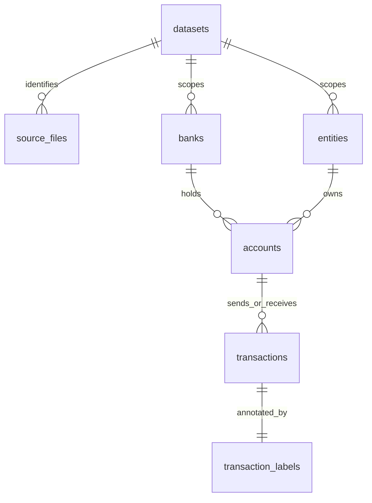

# PostgreSQL schema and ingestion

The importer loads the validated IBM AML HI-Small version-8 accounts and
transactions. It preserves every transaction, including repeated records and
transactions outside the advertised primary period. It does not create
predictive features, models, or an interface.

## Schema



The diagram shows the intended one-label-per-transaction relationship.
PostgreSQL enforces at most one label and no orphan label; reconciliation
enforces that every transaction has a label before completion.

| Table | Purpose and key |
| --- | --- |
| `mulegraph.schema_version` | Version 1 and the SHA-256 of its DDL; edited/unknown definitions are rejected |
| `mulegraph.datasets` | Unique dataset key and combined file fingerprint; provenance, validation audit, reconciliation, normalization version, start/completion times |
| `mulegraph.source_files` | `(dataset_id, file_name)`; original SHA-256, byte size, and source URL for each of the three files |
| `mulegraph.banks` | `(dataset_id, bank_id)`; canonical bank ID and bank name |
| `mulegraph.entities` | `(dataset_id, entity_id)`; original string ID and entity name |
| `mulegraph.accounts` | `(dataset_id, source_row)`; unique `(dataset_id, bank_id, account_number)`, original bank ID, generated canonical bank ID, entity FK |
| `mulegraph.transactions` | `(dataset_id, source_row)`; timestamp, both original bank IDs, generated canonical bank IDs, both account numbers, both amounts/currencies, payment format |
| `mulegraph_labels.transaction_labels` | `(dataset_id, source_row)` FK to transaction; 0/1 laundering label and full-source-record SHA-256 |

All IDs are text; none are inferred as integers or stripped of account-number
zeros. Banks and entities are dataset-scoped because another generated dataset
must not silently share identities with this one. Repeated bank/entity names
are stored once; conflicting names for the same identity reject ingestion.

Amounts use unrestricted PostgreSQL `NUMERIC`, avoiding floating-point error
and fixed-scale rounding of Bitcoin amounts. Both receiving and payment
currencies remain separate text columns. Checks reject negative values, NaN,
and infinities. No currency conversion is performed.

Event timestamps are `TIMESTAMP WITHOUT TIME ZONE`: the source provides no
timezone. Ingestion timestamps are `TIMESTAMPTZ`. Loading does not invent an
availability timestamp or make account metadata historically available.

## Bank normalization and source identity

`bank-padding-v1` accepts only ASCII digit strings and removes leading zeros,
mapping an all-zero string to `"0"`. It never casts to an integer and never
normalizes account or entity IDs. For example, a transaction's original bank
`"001"` maps to bank `"1"`, while account `"000A"` remains `"000A"`.

Normalization is implemented by an immutable SQL function and stored generated
columns. The validator must report zero normalization collisions and zero
unmatched composite identities. The importer also rejects duplicate normalized
account identities and conflicting dimensions in staging. Composite foreign
keys then enforce both sender and receiver account membership in the same
dataset. Raw bank strings remain in accounts and transactions.

`source_row` is the **1-based logical CSV record number, excluding the header**,
not a physical line number. Quoted multiline fields count as one record. The
stable external identity is `(dataset fingerprint, source filename, source_row)`;
database joins use the dataset surrogate ID plus source row. Duplicate content
receives distinct row numbers. There is no DISTINCT, upsert, or deduplication
on transaction content.

## Label isolation

The transaction table has no laundering column. Row-level labels and the
full-record digest that includes those labels live in `mulegraph_labels`.
PUBLIC has no access to that schema or its tables. The local database owner
still has access to both schemas; this is not a restriction on the owner.
Future application roles should receive only explicit core-schema grants.
Aggregate class counts in ingestion/validation metadata are audit results.

The patterns file remains an unchanged local annotation artifact. Its hash,
size, and source URL are recorded, but its annotations are not ingested in
ingestion stage. Labels and pattern outcomes must never become historical inputs.

## Transactionality, memory use, and reruns

1. Check every local file's SHA-256/size against both the acquisition manifest
   and a complete, error-free validation audit.
2. Acquire a transaction-scoped advisory lock per schema. Concurrent importer
   runs serialize; a lock wait beyond 15 seconds fails cleanly and can be retried.
3. Apply the versioned DDL or verify its existing definition hash.
4. Stream positional CSV records through Psycopg COPY into temporary PostgreSQL
   tables. Duplicate `Account` headers remain separate positions.
5. Normalize/load dimensions and accounts, then insert transactions and labels
   in batches of 100,000 within the **same** database transaction. This bounds
   PostgreSQL's per-statement FK-trigger queue as well as Python memory use.
6. Drop temporary staging tables, build indexes, run SQL reconciliation, and
   rehash raw inputs. Mark the dataset complete and commit only if all pass.

Failures roll back rows, DDL created in that transaction, and completion
metadata. PostgreSQL identity sequences may have gaps after a failed load;
source-row identifiers do not. Failed attempts are reported by the command,
not committed as partial datasets. The raw directory is read-only to the code.

The combined fingerprint is a deterministic SHA-256 of the sorted mapping of
the three filenames to their SHA-256/byte sizes. Identical reruns reconcile
existing rows and return `already_loaded`; they insert nothing. A reused dataset
key with different bytes is rejected. New versions require an explicit new
dataset key through the Python API, rather than overwriting existing rows.
Edited DDL requires an explicit migration, not silently changing version 1.

The CLI writes its JSON execution result after the database commit. If writing
that output fails, the database may already be complete; rerun safely to
reconcile it and regenerate the result. Keep sufficient host disk space for
database tables, indexes, temporary staging, and WAL, not just the raw CSVs.
Server `work_mem` is set locally to 32 MiB for these operations; this is a
per-operation setting, not a bound on total PostgreSQL memory.
Query parallelism is disabled locally (`max_parallel_workers_per_gather = 0`)
to avoid parallel hash joins exceeding Docker's default shared-memory capacity.
Neither setting changes PostgreSQL defaults or Docker Compose configuration.

## Indexes and SQL reconciliation

Primary/unique indexes cover datasets, files, banks, entities, account composite
identities, and transaction/label source rows. Additional indexes cover account
entity membership, sender/time, receiver/time, and a compact BRIN timestamp
index. Foreign keys are validated and active during loading; triggers are not
disabled. Sender/receiver indexes also support account FK lookups.

The SQL reconciliation checks compare the database with the exact byte-matched
validation JSON: transaction/account/label counts, contiguous source-row ranges,
binary class counts, duplicate source-record digests, banks/entities, reused
account numbers, orphan endpoints, unused accounts, timestamps, daily labels,
out-of-window labels, self-transfers, cross-currency rows, currency/payment-format
frequencies, and per-currency amount counts/min/max/zero counts. Stored source
file fingerprints must also match. Any failed check prevents completion.

Duplicate reconciliation counts repeated SHA-256 digests of the full original
parsed row, including its label. This preserves distinctions such as `1.10`
versus `1.100` and uses the same field serialization as validation. As with any
digest-based check, it assumes SHA-256 collision resistance. The raw file hashes
and unique source-row keys provide the provenance baseline; aggregate checks
are not a general tamper-proof database attestation.

## Commands

From the project root, install dependencies and configure a local `.env` as
described in [reproduction](reproducibility.md). Preserve an existing configuration
and dataset; use a separate database and workspace for a new reconstruction.

Start PostgreSQL and ingest:

```sh
docker compose up -d --wait
uv run --locked --env-file .env python -m mulegraph.ingestion \
  --output data/ingestion/first_load.json
```

Run the same importer again to verify idempotency, or explicitly request a
read-only, repeatable-read reconciliation:

```sh
uv run --locked --env-file .env python -m mulegraph.ingestion \
  --output data/ingestion/rerun.json
uv run --locked --env-file .env python -m mulegraph.ingestion \
  --verify-only --output data/ingestion/verification.json
```

Defaults: `data/raw/hi-small/`, `data/provenance/hi-small/manifest.json`, and
`data/validation/hi-small.json`. Override with `--raw-dir`, `--manifest`, and
`--audit`. Execution output is ignored by Git. Exit 0 means successful load or
verification; exit 1 means an operation failed; exit 2 covers missing database
configuration or invalid CLI arguments. No credentials appear in source code.

Run all tests with real PostgreSQL integration enabled:

```sh
uv run --locked --env-file .env sh -c \
  'MULEGRAPH_TEST_DATABASE_URL="$DATABASE_URL" uv run --locked pytest'
uv run --locked ruff check .
uv run --locked ruff format --check .
```

Integration tests create random `mg_test_*` and corresponding label schemas and
drop only those schemas. They require schema-creation privileges. They do not
truncate or modify the loaded dataset. Without the test URL, integration tests
explicitly skip; the remaining tests run without PostgreSQL.

Implementation: `src/mulegraph/ingestion.py`, `schema.py`, `reconciliation.py`,
and packaged SQL files in `src/mulegraph/sql/`. Use the importer to apply SQL
resources because their schema identifiers are safely substituted by Psycopg.

References: [Psycopg COPY](https://www.psycopg.org/psycopg3/docs/basic/copy.html),
[PostgreSQL COPY](https://www.postgresql.org/docs/17/sql-copy.html), and
[PostgreSQL constraints](https://www.postgresql.org/docs/17/ddl-constraints.html).
